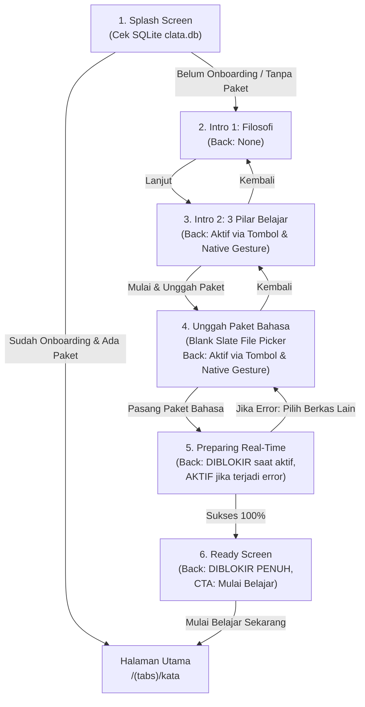

# Alur Onboarding Clata (User Flow)

Dokumen ini mendokumentasikan spesifikasi implementasi alur Onboarding Clata yang terintegrasi penuh dengan basis data lokal SQLite (`clata.db`), manajemen state terpusat (`AppContext`), dan pemasangan paket bahasa biner (`.clata` / `.zip`) dengan pembaruan progres *real-time*.

---

## 1. Prinsip Utama Alur Onboarding

1. **Prinsip Aplikasi Kosong (*Blank Slate*)**:
   - Aplikasi dimulai dalam keadaan kosong murni tanpa paket bawaan yang ter-bundle di awal (`installed_packages: []`, `active_package: null`).
   - Pengguna memilih berkas paket bahasa (`.clata` atau `.zip`) dari penyimpanan perangkat mereka sendiri.
2. **Offline-First & Zero-Network**:
   - Seluruh proses penyiapan, ekstraksi biner via `fflate`, verifikasi checksum SHA-256, dan verifikasi tanda tangan digital Ed25519 (JCS RFC 8785) berjalan 100% di perangkat tanpa koneksi internet.
3. **Isolasi Data Terjamin**:
   - Berkas biner `.clata` murni memuat aset bahasa (*read-only*) dan disimpan di internal storage (`packages/installed/<pkgId>/bundle.clata`).
   - Seluruh data status aplikasi (`onboarding_completed`), ID paket aktif, dan daftar paket terpasang disimpan terpisah di basis data SQLite lokal (`clata.db`).

---

## 2. Diagram Alur Navigasi & Kontrol Gesture

---

## 3. Rincian Layar demi Layar

### Layar 1: Splash Screen (`src/app/onboarding/splash.tsx`)
- **Tujuan**: Memeriksa status inisialisasi basis data SQLite lokal.
- **Logika Navigasi**:
  - Jika `isOnboardingCompleted === true` dan `activePackageId !== null` -> langsung beralih ke `/(tabs)/kata`.
  - Jika belum -> beralih ke `/onboarding/intro-1`.
- **Elemen UI**: Badge monogram "C" (`colors.primary`), judul "Clata", tagline "Celoteh Nusantara", dan loader `ActivityIndicator`.

---

### Layar 2: Intro 1 — Filosofi Rasa & Hubungan Harmonis (`src/app/onboarding/intro-1.tsx`)
- **Tujuan**: Mengenalkan filosofi inti bertutur kata bahasa daerah.
- **UX Copy**:
  - *Tajuk*: `"Belajar Bahasa Daerah dengan Rasa & Kesantunan"`
  - *Narasi*: *"Bahasa daerah adalah soal rasa, bahasa yang kamu ucapkan dengan warga lokal adalah kunci menciptakan hubungan yang harmonis"*
- **Navigasi**: Tombol CTA primer `"Lanjut"` menuju ke Intro 2.

---

### Layar 3: Intro 2 — Metode Belajar & Privasi Offline (`src/app/onboarding/intro-2.tsx`)
- **Tujuan**: Mengenalkan pilar pembelajaran mandiri tanpa kuota.
- **Tiga Pilar Ringkas**:
  1. **Audio Penutur Asli**: Rekaman suara penutur asli.
  2. **Skenario Percakapan Nyata**: Dialog interaktif interaksi sehari-hari.
  3. **100% Offline & Privat**: Semua data tersimpan di ponselmu tanpa koneksi internet.
- **Kontrol Navigasi**:
  - Tombol kembali di header (ikon `arrow-left-line`).
  - Native gesture back OS **diaktifkan** untuk kembali ke Intro 1.
  - Tombol CTA primer `"Mulai & Unggah Paket Bahasa"` menuju ke Select Package.

---

### Layar 4: Unggah Paket Bahasa Mandiri (`src/app/onboarding/select-package.tsx`)
- **Tujuan**: Memfasilitasi pengguna memilih berkas paket bahasa `.clata` dari penyimpanan perangkat.
- **Status Antarmuka**:
  - **Belum Ada Berkas**: Area dropzone border putus-putus dengan tombol `"Buka File Manager"`. Membuka pemilih berkas sistem (`expo-document-picker`).
  - **Berkas Dipilih**: Kartu solid dengan ikon sukses, nama berkas, ukuran berkas terformat (KB/MB), dan tombol `"Ganti"`.
- **Kontrol Navigasi**:
  - Tombol kembali di header dan native gesture back **diaktifkan** untuk kembali ke Intro 2.
  - Tombol CTA `"Pasang Paket Bahasa"` non-aktif jika berkas belum dipilih, dan aktif (`colors.primary`) begitu berkas valid telah dipilih.

---

### Layar 5: Penyiapan Paket Real-Time (`src/app/onboarding/preparing.tsx`)
- **Tujuan**: Menjalankan ekstraksi biner dan verifikasi nyata dengan pelaporan progres visual.
- **Tahapan Progres Real-Time**:
  - `10%`: *"Membuka berkas arsip .clata..."*
  - `30%`: *"Mengekstrak aset audio & kosakata daerah..."*
  - `55%`: *"Memverifikasi hash SHA-256 per berkas..."*
  - `75%`: *"Memverifikasi tanda tangan digital Ed25519..."*
  - `90%`: *"Memvalidasi kalimat kanonikal & skenario dialog..."*
  - `100%`: *"Menyimpan paket ke basis data lokal perangkat..."*
- **Kontrol Navigasi & Error Recovery**:
  - Saat proses berlangsung aktif: Tombol kembali dan gesture back **diblokir penuh** untuk mencegah inkonsistensi data.
  - Jika terjadi kesalahan verifikasi: Kartu error warna `magenta` ditampilkan dengan pesan penolakan yang jelas. Tombol kembali di header dan tombol pemulihan `"Pilih Berkas Lain"` **diaktifkan** untuk kembali ke `select-package`.

---

### Layar 6: Halaman Kesiapan (`src/app/onboarding/ready.tsx`)
- **Tujuan**: Konfirmasi akhir bahwa paket bahasa telah aktif dan terpasang rapi di SQLite.
- **Informasi Paket**: Menampilkan judul paket, dialek, statistik jumlah kata/kalimat/dialog, dan indikator penyimpanan internal.
- **Kontrol Navigasi**:
  - **Diblokir Penuh (Locked)**: Header back ditiadakan, gesture back native dinonaktifkan, dan `BackHandler` Android di-intercept.
  - Tombol CTA primer `"Mulai Belajar Sekarang"`: Menyimpan `onboarding_completed = true` ke tabel `app_settings` di SQLite dan mengarahkan pengguna ke halaman utama `/(tabs)/kata`.
