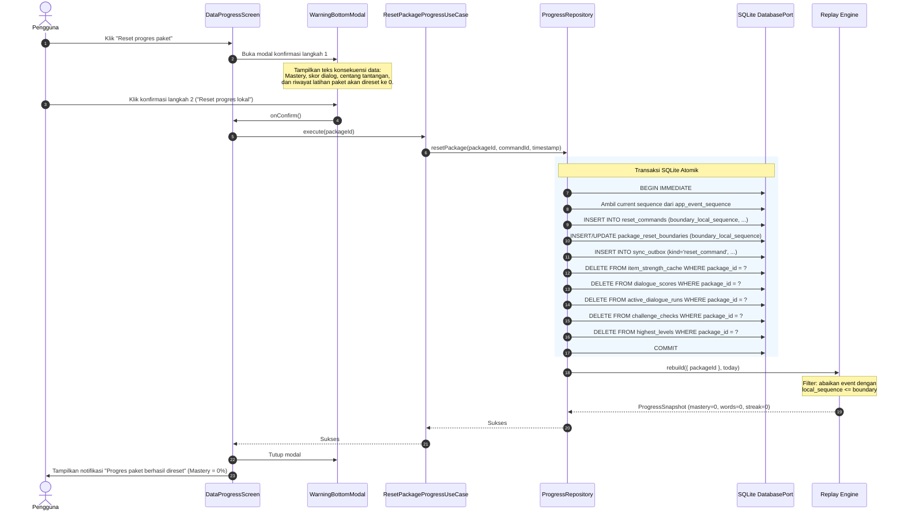
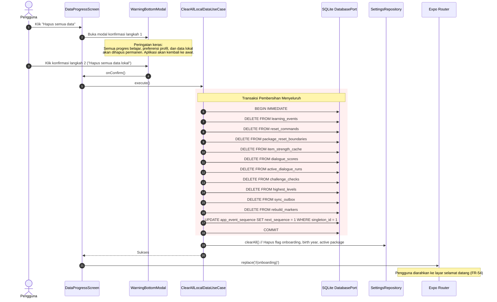
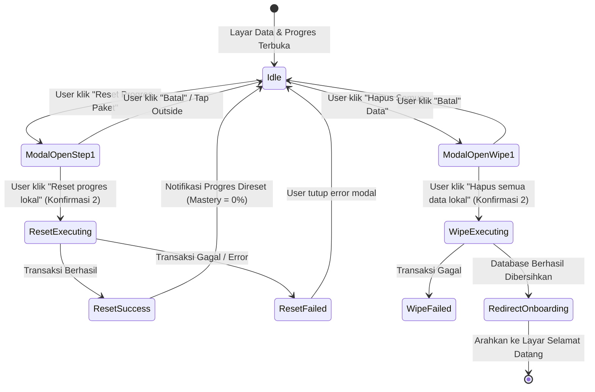

# P0 Implementation Plan 8 — Settings, QA & P0 Release Gate

## 1. Tujuan

Plan 8 adalah tahap finalisasi, pengerasan mutu (hardening), kepatuhan regulasi, dan gerbang rilis (release gate) untuk seluruh pencapaian **P0 Clata**:

- menyediakan antarmuka **Pengaturan** terpusat di tab **Profil** dengan navigasi yang aman, hierarki yang jelas, dan pemisahan tegas antara aksi rutin dan aksi destruktif;
- mengimplementasikan **FR-55 (Reset Progres per Paket)** menggunakan modal konfirmasi dua langkah (*two-step confirmation*), isolasi *tombstone sequence boundary*, pembersihan *item strength cache*, skor dialog, centang tantangan, dan hari aktif paket tanpa menghapus atau mengganggu paket lain;
- mengimplementasikan **FR-55 (Hapus Semua Data)** menggunakan konfirmasi dua langkah untuk mereset seluruh data lokal SQLite dan mengembalikan aplikasi ke kondisi instalasi baru (*fresh onboarding state*);
- mengimplementasikan **FR-56 (Halaman Tentang / About Screen)** yang dapat diakses 100% offline, memuat identitas & versi aplikasi, rincian paket terpasang (`jawa-mataraman v1.0.0`), atribusi kontributor dan penutur asli, lisensi konten (teks CC BY-SA 4.0 vs lisensi tertutup audio per PRD 11.7), ringkasan kebijakan privasi, batas usia minimum 10 tahun (UU PDP / PP 17/2025 / Permenkomdigi 9/2026), serta kanal pelaporan pelanggaran hak anak dan penyalahgunaan via surel (`lapor@clata.id`);
- memastikan audit aksesibilitas **WCAG 2.2 AA** terpenuhi: target sentuh minimum 48×48 dp / 44×44 pt, kontras warna $\ge$ 4.5:1, skala Dynamic Type hingga 200%, *focus containment* pada modal konfirmasi destruktif, dan pelabelan *screen reader* (TalkBack/VoiceOver);
- memverifikasi alur penuh dalam mode pesawat (**Airplane-Mode Journey**) dari pembukaan pertama, instalasi paket atomik, feed kosakata, latihan (Guess the Word & Fill the Gap), dialog kurasi, tantangan dunia nyata, hingga pengaturan dan reset data tanpa permintaan jaringan sama sekali;
- menjamin integritas paket rilis tunggal (**Single Package Build Guarantee**) bahwa *bundle* rilis hanya memuat paket kurasi `jawa-mataraman`;
- menyusun **P0 Release Gate Checklist & Sign-off** komprehensif sebagai bukti siap rilis sebelum masuk ke fase P1.

---

## 2. Sumber keputusan dan aturan yang wajib dipatuhi

Rincian dokumen ini diturunkan langsung dari spesifikasi PRD dan desain sistem:

- `PRD_clata.md` Bagian 7.6 (Pengaturan dan Akun), Bagian 7.9 (Paket Bahasa), Bagian 8.7 (Aturan Pembaruan Paket), Bagian 9 (Penyimpanan dan Sinkronisasi), Bagian 11.7 (Data Anak, Privasi, dan Lisensi Konten), Bagian 14 (Strategi Keamanan dan Privasi), Bagian 17.2, dan Bagian 17.5;
- `docs/spec.md`;
- `docs/sqlite-schema.md`;
- `docs/data-model.md`;
- `docs/design/screen/settings.md`;
- `docs/design/screen/about.md`;
- `docs/design/screen/data-progress.md`;
- `docs/design/flows/settings-recovery.md`;
- `docs/design/accessibility.md`;
- `docs/implementation_plan/imp_3.md` (Bab 10: Reset Semantics & P1 Compatibility);
- `docs/implementation_plan/imp_4.md` (Onboarding & Local Profile);
- `docs/implementation_plan/imp_7.md` (Dialogue & Challenge State).

### Settings & Destructive Action Rules

1. **Konfirmasi Dua Langkah Wajib**: Tidak ada aksi destruktif (reset paket atau hapus semua data) yang dieksekusi dengan satu kali klik. Aksi selalu melalui *warning bottom modal* dengan teks konsekuensi yang eksplisit, tombol `Batal`, dan tombol tindakan bernama tegas (misal: `Reset progres lokal` atau `Hapus semua data`).
2. **Focus Containment**: Selama modal konfirmasi terbuka, fokus *screen reader* dan keyboard harus terkurung di dalam modal. Menutup modal mengembalikan fokus visual dan aksesibilitas ke tombol pemicu (*trigger button*).
3. **Atomisitas Transaksi**: Eksekusi reset berjalan di dalam satu transaksi SQLite atomik (`BEGIN IMMEDIATE ... COMMIT`). Jika terjadi interupsi, *crash*, atau kehabisan daya di tengah eksekusi, database di-*rollback* secara utuh tanpa meninggalkan kondisi setengah jadi (*corrupted state*).
4. **Isolasi Antar Paket**: Reset progres pada satu paket hanya memengaruhi data dan event paket tersebut. Paket lain yang terpasang tetap utuh.

### Compliance & Child Safety Rules

1. **Ketersediaan Offline Mutlak**: Halaman Tentang, kebijakan privasi, informasi lisensi, dan informasi kanal pengaduan harus tersimpan lokal dan dapat dibaca kapan saja tanpa jaringan (FR-56).
2. **Pemisahan Lisensi Teks dan Audio**: Sesuai PRD Bagian 11.7, teks konten dilisensikan dengan Creative Commons Attribution-ShareAlike 4.0 International (CC BY-SA 4.0). Rekaman audio penutur asli **tidak dilisensikan terbuka** melainkan tunduk pada izin penggunaan terbatas yang diberikan langsung oleh penutur kepada Clata. Aplikasi dilarang mencantumkan klaim bahwa seluruh aset adalah domain publik atau open-source tanpa diferensiasi ini.
3. **Kepatuhan Perlindungan Anak**: Batas usia minimum 10 tahun (UU No. 27/2022 tentang Perlindungan Data Pribadi, PP No. 17/2025 tentang Tata Kelola Penyelenggaraan Sistem Elektronik dalam Perlindungan Anak, Permenkomdigi No. 9/2026) harus diumumkan dengan jelas.
4. **Kanal Pengaduan Hak Anak**: Kanal surel pengaduan konten dan hak anak (`lapor@clata.id`) wajib tersedia jelas, dilengkapi aksi salin surel (*copy to clipboard*) dan pembuka surel bawaan (*mailto*).

---

## 3. Requirements mapping

| PRD / NFR | Ringkasan Persyaratan | Implementasi Plan 8 | Evidence & Test Wajib |
|---|---|---|---|
| **FR-55** | Reset progres per paket: konfirmasi 2 langkah, menghapus log/boundary, kekuatan, skor dialog, centang tantangan, dan hari aktif paket. Reset 1 paket tidak mengubah paket lain. Setelah reset, mastery paket itu 0%. | `ResetPackageProgressUseCase`, `package_reset_boundaries`, `reset_commands`, pembersihan cache lokal. | Unit test use case, SQLite transaction integration test, boundary property test. |
| **FR-55** | Hapus semua data: konfirmasi 2 langkah, menghapus seluruh event, progres, profil/onboarding, dan mengembalikan aplikasi ke kondisi baru (*fresh install*). | `ClearAllLocalDataUseCase`, pembersihan tabel user & state, reset flags onboarding. | Database reset test, transition to onboarding E2E test. |
| **FR-56** | Halaman Tentang: versi aplikasi dan paket, kredit kontributor dan penutur, lisensi konten (teks CC BY-SA 4.0, audio berhak cipta), kebijakan privasi, batas usia minimum 10 tahun, kanal pelaporan surel. Semuanya tampil offline. | `AboutScreen`, `GetAboutMetadataUseCase`, local metadata provider, `CopyEmailButton`. | Contract test metadata, rendering offline test, copy/mailto interaction test. |
| **NFR-01** | Zero network dependency untuk semua fitur P0 (100% offline). | Seluruh use case Plan 8 tidak memuat impor modul jaringan atau fetch HTTP. | Airplane mode validation test. |
| **NFR-04** | Startup aplikasi $\le$ 2 detik pada perangkat entry-level. | Optimasi inisialisasi query settings & metadata cache. | Startup benchmark test. |
| **NFR-05** | Latensi navigasi dan rendering modal $\le$ 100 ms tanpa frame drop. | Memoized modal callbacks, native driver animations. | Interaction performance test. |
| **NFR-A11Y** | Kepatuhan WCAG 2.2 AA: touch target $\ge$ 48×48 dp, kontras $\ge$ 4.5:1, dynamic type 200%, TalkBack/VoiceOver support, modal focus containment. | Audit komponen `SettingsRow`, `WarningModal`, `AboutScreen`, `DataProgressScreen`. | Accessibility tree test, target size inspection, automated contrast test. |
| **NFR-PKG** | Single package release bundle (hanya memuat paket `jawa-mataraman`). | Verifikasi skrip bundling dan manifest installer. | Release artifact validation script. |

---

## 4. Scope

### Termasuk di Plan 8 (P0)

1. Navigasi Settings di tab Profil (`Profil → Pengaturan`):
   - Row `Paket Bahasa` (informasi paket aktif `Jawa (Mataraman) v1.0.0`);
   - Row `Data dan progres` (membuka layar manajemen data);
   - Row `Tentang Clata` (membuka layar informasi aplikasi dan kepatuhan hukum).
2. Layar `Data dan Progres`:
   - Ringkasan penyimpanan lokal (ukuran basis data & konten);
   - Tombol `Reset progres paket` dengan peringatan dan konfirmasi dua langkah;
   - Tombol `Hapus semua data` dengan peringatan dan konfirmasi dua langkah.
3. Modal konfirmasi destruktif (`WarningBottomModal`):
   - Judul peringatan yang jelas dan deskripsi konsekuensi data;
   - Tombol pembatalan eksplisit `Batal`;
   - Tombol konfirmasi kedua dengan penamaan spesifik (`Reset progres lokal` / `Hapus semua data`).
4. Engine reset lokal:
   - Pencatatan `reset_commands` dan `package_reset_boundaries`;
   - Pembersihan `item_strength_cache` paket;
   - Pembersihan `dialogue_scores` dan pembatalan `active_dialogue_runs` paket;
   - Pembersihan `challenge_checks` paket;
   - Perhitungan ulang derived progress yang menghasilkan mastery = 0% dan active days = 0 untuk paket tersebut;
   - Pembersihan seluruh data lokal pada aksi `Hapus semua data`.
5. Layar `Tentang Clata`:
   - Logo Clata dan nama aplikasi;
   - Versi aplikasi (`app.json`) dan versi paket bahasa terpasang;
   - Bagian kredit: nama kontributor kurasi dan penutur asli (POC);
   - Bagian lisensi: teks CC BY-SA 4.0 dan pernyataan hak cipta terbatas audio;
   - Bagian batas usia: pernyataan batas usia minimum 10 tahun (UU PDP / PP 17/2025 / Permenkomdigi 9/2026);
   - Bagian privasi: komitmen pemrosesan data murni di perangkat;
   - Bagian pelaporan: alamat surel `lapor@clata.id` dengan tombol salin dan tautan `mailto`.
6. Pengujian komprehensif & sign-off release gate.

### Tidak Termasuk di Plan 8 (Dialokasikan ke P1/P2)

1. **Supabase Auth & Cloud Sync (P1 — FR-51, FR-51A)**: Sinkronisasi outbox ke server, login surel/Google, penanganan token JWT.
2. **Hapus Akun Server (P1 — FR-58)**: Endpoint penghapusan akun Supabase Auth dan cascading delete di backend Postgres.
3. **Ekspor & Impor Cadangan Data Belajar (P1 — FR-53)**: Serialisasi file JSON cadangan untuk ditransfer antarperangkat.
4. **Unduh Paket Tambahan & Hapus Paket (P1 — FR-83, FR-86, FR-88)**: Unduhan katalog, penghapusan file zip paket tambahan.
5. **Pengingat Harian Lokal (P1 — FR-57)**: Integrasi notifikasi lokal terjadwal.
6. **Pelaporan Kesalahan Konten Kurasi per Item (P1 — FR-59)**: Form interaktif pelaporan kata/dialog yang membutuhkan jaringan.
7. **Pengaturan Dialog AI (P1)**: Kuota, model switcher, dan preferensi AI.

---

## 5. Arsitektur dan data flow

### 5.1 Hierarki Navigasi Settings

```text
Tab Profil (src/app/(tabs)/profil.tsx)
  │
  ├── User Profile Header & Ringkasan Progres
  │
  └── Bagian Pengaturan (Vertical Action List)
        │
        ├── [Row] Paket Bahasa ──────────> Modal / Info Paket Aktif (Jawa-Mataraman)
        │
        ├── [Row] Data dan Progres ──────> Layar Data & Progres
        │                                    │
        │                                    ├── Ringkasan Penyimpanan
        │                                    ├── [Button] Reset Progres Paket
        │                                    │     └─> Warning Modal (Konfirmasi 2 Langkah)
        │                                    │           └─> Execute Reset Package
        │                                    │
        │                                    └── [Button] Hapus Semua Data
        │                                          └─> Warning Modal (Konfirmasi 2 Langkah)
        │                                                └─> Execute Clear All Local Data
        │                                                      └─> Reset App to Onboarding
        │
        └── [Row] Tentang Clata ─────────> Layar Tentang Clata (AboutScreen)
                                             ├── Identitas & Versi (App + Package)
                                             ├── Kredit Kontributor & Penutur
                                             ├── Lisensi Konten (Teks CC BY-SA 4.0 / Audio)
                                             ├── Batasan Usia (Min. 10 Tahun)
                                             ├── Ringkasan Kebijakan Privasi
                                             └── Kanal Pelaporan (lapor@clata.id)
```

### 5.2 Sekuens Reset Progres per Paket (FR-55)



### 5.3 Sekuens Hapus Semua Data (FR-55)



---

## 6. Domain contracts

Semua tipe kontrak domain didefinisikan murni menggunakan TypeScript tanpa dependensi eksternal:

### 6.1 Reset & Data Management Types (`src/features/settings/domain/settingsTypes.ts`)

```typescript
export interface ResetCommand {
  commandId: string;
  packageId: string;
  issuedAt: string;
  localAppliedAt: string;
  tombstoneVersion: number;
  boundaryLocalSequence: number;
  boundaryDeviceTime: string;
  boundaryEventId: string;
  status: 'local_pending' | 'synced';
}

export interface PackageResetBoundary {
  packageId: string;
  resetCommandId: string;
  boundaryLocalSequence: number;
  boundaryDeviceTime: string;
  boundaryEventId: string;
  updatedAt: string;
}

export interface StorageInfo {
  databaseSizeBytes: number;
  databaseSizeFormatted: string;
  packageId: string;
  packageName: string;
  packageVersion: string;
  totalEventsCount: number;
  learnedItemsCount: number;
}
```

### 6.2 About & Compliance Types (`src/features/settings/domain/aboutTypes.ts`)

```typescript
export interface ContributorCredit {
  name: string;
  role: string;
  dialectOrRegion?: string;
  note?: string;
}

export interface ContentLicenseInfo {
  textLicense: {
    name: string;
    code: 'CC-BY-SA-4.0';
    url: string;
    summary: string;
  };
  audioLicense: {
    name: string;
    isPublicLicense: false;
    summary: string;
    attributionNotice: string;
  };
}

export interface CompliancePolicy {
  minimumAgeYears: 10;
  legalBasis: string[]; // ['UU PDP No. 27/2022', 'PP No. 17/2025', 'Permenkomdigi No. 9/2026']
  privacySummary: {
    noAccountRequired: boolean;
    localStorageOnly: boolean;
    noAnalyticsOrAds: boolean;
    noBackgroundTracking: boolean;
  };
  reportingChannel: {
    email: string; // 'lapor@clata.id'
    subjectPrefix: string; // '[Laporan Clata P0]'
    purpose: string;
  };
}

export interface AboutMetadata {
  appName: string;
  appVersion: string;
  buildNumber: string;
  activePackage: {
    packageId: string;
    languageName: string;
    dialectName: string;
    version: string;
  };
  credits: ContributorCredit[];
  licenses: ContentLicenseInfo;
  compliance: CompliancePolicy;
}
```

### 6.3 Domain Errors (`src/features/settings/domain/settingsErrors.ts`)

```typescript
export type SettingsErrorCode =
  | 'RESET_FAILED'
  | 'CLEAR_DATA_FAILED'
  | 'PACKAGE_NOT_FOUND'
  | 'METADATA_LOAD_FAILED'
  | 'TRANSACTION_ABORTED';

export class SettingsError extends Error {
  constructor(
    public readonly code: SettingsErrorCode,
    message: string,
    public readonly cause?: unknown
  ) {
    super(message);
    this.name = 'SettingsError';
  }
}

export function createSettingsError(
  code: SettingsErrorCode,
  message: string,
  options?: { cause?: unknown }
): SettingsError {
  return new SettingsError(code, message, options?.cause);
}
```

---

## 7. Reset progres per paket rules (FR-55)

1. **Two-Step Confirmation Invariant**:
   - Langkah 1: Pengguna menekan tombol pemicu `Reset progres paket` pada layar *Data dan progres*.
   - Langkah 2: Bottom sheet / modal peringatan muncul menampilkan rincian data yang akan terhapus. Pengguna harus menekan tombol konfirmasi eksplisit dengan teks `Reset progres lokal` (bukan sekadar `OK` atau `Lanjutkan`).
   - Jika pengguna membatalkan (menekan `Batal` atau *tap outside* / menekan tombol *back* perangkat), tidak ada perubahan basis data apa pun.
2. **Boundary Sequence Invariant**:
   - Reset tidak menghapus baris fisik dari tabel `learning_events` guna menjaga kompatibilitas sinkronisasi outbox di fase P1.
   - Sebagai gantinya, sistem mengambil nilai `next_sequence - 1` dari tabel `app_event_sequence` sebagai `boundary_local_sequence`.
   - Record baru disisipkan ke tabel `reset_commands` dan di-*upsert* ke `package_reset_boundaries`.
   - Semua event lama dari paket tersebut yang memiliki `local_sequence <= boundary_local_sequence` diabaikan secara permanen oleh `replayProgress()`.
3. **Pembersihan Cache Turunan & Tabel Pendukung**:
   Di dalam transaksi reset yang sama, tabel-tabel turunan berikut wajib dibersihkan untuk `packageId` yang bersangkutan:
   - `item_strength_cache`: seluruh baris `word` dan `sentence` paket dihapus;
   - `dialogue_scores`: seluruh rekor skor dialog paket dihapus;
   - `active_dialogue_runs`: sesi dialog yang sedang berjalan untuk paket tersebut dibatalkan;
   - `challenge_checks`: seluruh centang tantangan paket dihapus;
   - `highest_levels`: rekor level tertinggi paket direset;
   - `rebuild_markers`: marker rebuild dipasang untuk paket tersebut dan scope global.
4. **Verifikasi Pasca-Reset**:
   - Setelah transaksi commit, pemanggilan `getProgressSummary(packageId)` menghasilkan:
     - `masteryPercentage = 0%`;
     - `highestLevelAchieved = 0`;
     - `learnedWordsCount = 0`;
     - `activeDaysCount = 0`;
     - `currentStreak = 0` (bila paket aktif adalah satu-satunya paket terpasang).
   - Layar Latihan dan Kosakata segera menampilkan kondisi fresh (tidak ada kata yang berstatus "dipelajari", dialog belum memiliki skor).
5. **Jaminan Independensi Paket**:
   - Query reset secara tegas memakai filter `WHERE package_id = ?`.
   - Data paket lain (jika di kemudian hari ada paket tambahan di P1) tidak tersentuh.

---

## 8. Hapus semua data rules (FR-55)

1. **Two-Step Confirmation Invariant**:
   - Langkah 1: Pengguna memilih tombol `Hapus semua data`.
   - Langkah 2: Modal peringatan berat (*destructive modal*) muncul dengan pesan yang sangat jelas:
     > *"Tindakan ini akan menghapus semua riwayat belajar, preferensi profil, dan pengaturan lokal di perangkat ini secara permanen. Aplikasi akan kembali ke kondisi awal seperti baru dipasang."*
   - Pengguna harus menekan tombol konfirmasi kedua bertuliskan `Hapus semua data lokal`.
2. **Pembersihan Menyeluruh (*Total Wipe*)**:
   - Di dalam transaksi SQLite atomik:
     ```sql
     DELETE FROM learning_events;
     DELETE FROM reset_commands;
     DELETE FROM package_reset_boundaries;
     DELETE FROM item_strength_cache;
     DELETE FROM dialogue_scores;
     DELETE FROM active_dialogue_runs;
     DELETE FROM challenge_checks;
     DELETE FROM highest_levels;
     DELETE FROM sync_outbox;
     DELETE FROM rebuild_markers;
     UPDATE app_event_sequence SET next_sequence = 1 WHERE singleton_id = 1;
     ```
   - Catatan: Tabel konten paket (`words`, `sentences`, `dialogues`, `challenges`, `installed_packages`) **tidak dihapus** dari basis data agar pengguna tidak perlu melakukan ekstraksi paket ulang saat membuka aplikasi kembali (paket bundel `jawa-mataraman` tetap dalam status valid/aktif).
3. **Pembersihan Penyimpanan Pengaturan Lokal**:
   - Status onboarding `onboardingCompleted` disetel menjadi `false`.
   - Tahun lahir pengguna (`birth_year`) dihapus.
   - Pilihan preferensi lain dihapus dari penyimpanan lokal (`SettingsRepository` / AsyncStorage / secure store).
4. **Transisi Navigasi**:
   - Aplikasi segera melakukan reset navigasi (*navigation replace*) ke rute onboarding awal (`src/app/(onboarding)` atau `/`), menampilkan alur selamat datang FR-54.

---

## 9. About screen & compliance rules (FR-56)

Halaman Tentang Clata memuat 6 komponen informasi wajib yang disajikan secara terstruktur dan dapat diakses 100% offline:

### 9.1 Identitas dan Versi

- Menampilkan logo Clata (dengan `accessibilityElementsHidden={true}` atau `importantForAccessibility="no"` bila heading teks nama aplikasi sudah ada).
- Nama aplikasi: **Clata**.
- Versi aplikasi: diambil dari manifest Expo/app.json (misal: `v1.0.0 (Build 1)`).
- Paket bahasa terpasang: **Jawa — Dialek Mataraman (v1.0.0)**.

### 9.2 Kredit Kontributor dan Penutur Asli

- Menampilkan daftar kontributor penyusun korpus kata, kalimat latihan, dan skenario dialog.
- Menampilkan atribusi penutur asli (*native speaker*) rekaman audio sesuai dengan persetujuan penutur (misal: penutur kurasi POC dan penutur asli Mataraman).
- Label status konten: Kurasi penutur asli Jawa-Mataraman terverifikasi.

### 9.3 Lisensi Konten (Diferensiasi Wajib PRD 11.7)

- **Lisensi Teks**:
  - Dilisensikan di bawah **Creative Commons Attribution-ShareAlike 4.0 International (CC BY-SA 4.0)**.
  - Ringkasan hak: bebas disalin, dibagikan, dan diadaptasi untuk tujuan apa pun dengan atribusi yang sesuai dan lisensi serupa.
- **Lisensi Audio**:
  - **Bukan lisensi terbuka**.
  - Rekaman suara penutur asli dilindungi hak cipta dengan izin penggunaan terbatas yang diberikan secara eksklusif kepada Clata.
  - Salinan rekaman audio tidak boleh didistribusikan ulang atau diekstrak secara terpisah tanpa izin tertulis dari pemegang hak cipta.

### 9.4 Batasan Usia Pengguna (Regulasi UU PDP & PP Tunas)

- Menampilkan pernyataan resmi kepatuhan:
  > *"Aplikasi Clata ditujukan untuk pengguna berusia **10 tahun ke atas**. Dirancang sesuai prinsip perlindungan anak dalam penyelenggaraan sistem elektronik (UU PDP No. 27/2022, PP No. 17/2025, dan Permenkomdigi No. 9/2026)."*
- Penjelasan bahwa tahun lahir hanya disimpan secara lokal di perangkat dan tidak pernah dikirim ke server.

### 9.5 Ringkasan Kebijakan Privasi

- **Tanpa Akun (P0)**: Belajar sepenuhnya tanpa kewajiban membuat akun atau mendaftar.
- **Tanpa Iklan & Pelacak**: Bebas dari pelacak analitik pihak ketiga (*third-party trackers*), SDK iklan, maupun telemetri perilaku pengguna.
- **Penyimpanan Lokal**: Seluruh data riwayat belajar dan progres tersimpan aman di penyimpanan internal ponsel pengguna.

### 9.6 Kanal Pelaporan Penyalahgunaan & Hak Anak

- Alamat surel resmi: **`lapor@clata.id`**.
- Tombol aksi:
  1. `Salin alamat surel`: menyalin `lapor@clata.id` ke clipboard dengan konfirmasi toast / teks visual dan *accessibility announcement* (*"Alamat surel pelaporan disalin"*).
  2. `Kirim surel`: memicu `Linking.openURL('mailto:lapor@clata.id?subject=%5BLaporan%20Clata%5D')` untuk membuka aplikasi surel bawaan perangkat.

---

## 10. SQLite persistence & reset transaction

### 10.1 Skema Tabel Terkait

Skema telah disiapkan sejak Plan 3 (`0001_initial_schema.ts`):

```sql
CREATE TABLE IF NOT EXISTS reset_commands (
  command_id TEXT PRIMARY KEY NOT NULL,
  package_id TEXT NOT NULL,
  issued_at TEXT NOT NULL,
  local_applied_at TEXT NOT NULL,
  tombstone_version INTEGER NOT NULL,
  boundary_local_sequence INTEGER NOT NULL,
  boundary_device_time TEXT NOT NULL,
  boundary_event_id TEXT NOT NULL,
  status TEXT NOT NULL CHECK (status IN ('local_pending', 'synced'))
);

CREATE TABLE IF NOT EXISTS package_reset_boundaries (
  package_id TEXT PRIMARY KEY NOT NULL,
  reset_command_id TEXT NOT NULL REFERENCES reset_commands(command_id),
  boundary_local_sequence INTEGER NOT NULL,
  boundary_device_time TEXT NOT NULL,
  boundary_event_id TEXT NOT NULL,
  updated_at TEXT NOT NULL
);

CREATE TABLE IF NOT EXISTS sync_outbox (
  outbox_id TEXT PRIMARY KEY NOT NULL,
  kind TEXT NOT NULL CHECK (kind IN ('learning_event', 'reset_command')),
  event_id TEXT,
  command_id TEXT,
  idempotency_key TEXT NOT NULL UNIQUE,
  account_id TEXT,
  status TEXT NOT NULL CHECK (status IN ('pending', 'in_flight', 'synced', 'failed')),
  attempt_count INTEGER NOT NULL DEFAULT 0
);
```

### 10.2 Kueri Transaksi Reset Paket

```typescript
await this.database.transaction(async (transaction) => {
  // 1. Cek idempotensi commandId
  const existing = await transaction.get<{ command_id: string }>(
    'SELECT command_id FROM reset_commands WHERE command_id = ?',
    [commandId]
  );
  if (existing) return;

  // 2. Ambil batas frontier sequence saat ini
  const sequenceRow = await transaction.get<{ next_sequence: number }>(
    'SELECT next_sequence FROM app_event_sequence WHERE singleton_id = 1'
  );
  const boundary = Number(sequenceRow?.next_sequence ?? 1) - 1;

  // 3. Catat reset command
  await transaction.run(
    `INSERT INTO reset_commands (
      command_id, package_id, issued_at, local_applied_at, tombstone_version,
      boundary_local_sequence, boundary_device_time, boundary_event_id, status
    ) VALUES (?, ?, ?, ?, ?, ?, ?, ?, ?)`,
    [commandId, packageId, deviceTime, nowIso, 1, boundary, deviceTime, commandId, 'local_pending']
  );

  // 4. Perbarui atau buat package_reset_boundaries
  await transaction.run(
    `INSERT INTO package_reset_boundaries(
      package_id, reset_command_id, boundary_local_sequence, boundary_device_time, boundary_event_id, updated_at
    ) VALUES (?, ?, ?, ?, ?, ?)
    ON CONFLICT(package_id) DO UPDATE SET
      reset_command_id = excluded.reset_command_id,
      boundary_local_sequence = excluded.boundary_local_sequence,
      boundary_device_time = excluded.boundary_device_time,
      boundary_event_id = excluded.boundary_event_id,
      updated_at = excluded.updated_at
    WHERE excluded.boundary_local_sequence > package_reset_boundaries.boundary_local_sequence`,
    [packageId, commandId, boundary, deviceTime, commandId, nowIso]
  );

  // 5. Masukkan ke outbox (P0 bersiap untuk P1)
  await transaction.run(
    `INSERT OR IGNORE INTO sync_outbox(
      outbox_id, kind, command_id, idempotency_key, account_id, status, attempt_count
    ) VALUES (?, ?, ?, ?, ?, ?, ?)`,
    [commandId, 'reset_command', commandId, `reset:${commandId}`, null, 'pending', 0]
  );

  // 6. Hapus cache turunan paket
  await transaction.run('DELETE FROM item_strength_cache WHERE package_id = ?', [packageId]);
  await transaction.run('DELETE FROM dialogue_scores WHERE package_id = ?', [packageId]);
  await transaction.run('DELETE FROM active_dialogue_runs WHERE package_id = ?', [packageId]);
  await transaction.run('DELETE FROM challenge_checks WHERE package_id = ?', [packageId]);
  await transaction.run('DELETE FROM highest_levels WHERE package_id = ?', [packageId]);

  // 7. Tandai marker rebuild
  await transaction.run(
    'INSERT OR REPLACE INTO rebuild_markers(scope_type, scope_id, reason, requested_at, formula_version) VALUES (?, ?, ?, ?, ?)',
    ['package', packageId, 'reset', nowIso, 1]
  );
  await transaction.run(
    'INSERT OR REPLACE INTO rebuild_markers(scope_type, scope_id, reason, requested_at, formula_version) VALUES (?, ?, ?, ?, ?)',
    ['global', 'all', 'reset', nowIso, 1]
  );
});
```

---

## 11. Event contract dan reset replay impact

### 11.1 Isolasi Replay dari Event Lama

Pada `SQLiteProgressRepository.rebuild()`, filter boundary diterapkan secara ketat:

```typescript
const boundary = await database.get<{ boundary_local_sequence: number }>(
  'SELECT boundary_local_sequence FROM package_reset_boundaries WHERE package_id = ?',
  [scope.packageId]
);

const visibleEvents = boundary
  ? events.data.filter((event) => event.localSequence > Number(boundary.boundary_local_sequence))
  : events.data;

const snapshot = replayProgress(visibleEvents, scope, today, newItemIds);
```

### 11.2 Mengapa Event Lama Tidak Boleh Dihapus Fisik pada P0?

1. **Kompatibilitas Sinkronisasi P1**: Saat pengguna menghubungkan akun di P1, outbox akan mengunggah record `reset_command` ke server. Jika event lokal dihapus secara fisik tanpa jejak tombstone, server yang sudah memiliki salinan event lama bisa saja mengirim kembali event tersebut saat proses *bidirectional merge*, yang menyebabkan progres terhapus hidup kembali (*zombie progress resurrection*).
2. **Audit & Determinisme**: State mesin belajar dapat diaudit secara matematis. Boundary bertindak sebagai penanda logis (*logical snapshot cut-off*).

---

## 12. Interfaces dan application use cases

### 12.1 `ResetPackageProgressUseCase` (`src/features/settings/application/resetPackageProgress.ts`)

```typescript
export interface ResetPackageProgressInput {
  packageId: string;
}

export interface ResetPackageProgressOutput {
  success: boolean;
  packageId: string;
  resetAt: string;
}

export class ResetPackageProgressUseCase {
  constructor(
    private readonly progressRepository: ProgressRepository,
    private readonly now: () => string = () => new Date().toISOString(),
    private readonly generateId: () => string = () => `reset_${Date.now()}_${Math.random().toString(36).substring(2, 9)}`
  ) {}

  async execute(input: ResetPackageProgressInput): Promise<RepositoryResult<ResetPackageProgressOutput>> {
    const commandId = this.generateId();
    const timestamp = this.now();
    const result = await this.progressRepository.resetPackage(input.packageId, commandId, timestamp);
    if (!result.ok) {
      return result;
    }
    // Lakukan rebuild langsung agar cache derived ter-refresh ke state 0
    await this.progressRepository.rebuild({ packageId: input.packageId }, timestamp.substring(0, 10));
    return {
      ok: true,
      data: {
        success: true,
        packageId: input.packageId,
        resetAt: timestamp,
      },
    };
  }
}
```

### 12.2 `ClearAllLocalDataUseCase` (`src/features/settings/application/clearAllLocalData.ts`)

```typescript
export interface ClearAllLocalDataOutput {
  success: boolean;
  clearedAt: string;
}

export class ClearAllLocalDataUseCase {
  constructor(
    private readonly database: DatabasePort,
    private readonly settingsRepository: SettingsRepository,
    private readonly now: () => string = () => new Date().toISOString()
  ) {}

  async execute(): Promise<RepositoryResult<ClearAllLocalDataOutput>> {
    try {
      await this.database.transaction(async (transaction) => {
        await transaction.run('DELETE FROM learning_events');
        await transaction.run('DELETE FROM reset_commands');
        await transaction.run('DELETE FROM package_reset_boundaries');
        await transaction.run('DELETE FROM item_strength_cache');
        await transaction.run('DELETE FROM dialogue_scores');
        await transaction.run('DELETE FROM active_dialogue_runs');
        await transaction.run('DELETE FROM challenge_checks');
        await transaction.run('DELETE FROM highest_levels');
        await transaction.run('DELETE FROM sync_outbox');
        await transaction.run('DELETE FROM rebuild_markers');
        await transaction.run('UPDATE app_event_sequence SET next_sequence = 1 WHERE singleton_id = 1');
      });

      // Bersihkan state onboarding & profile
      await this.settingsRepository.set('onboarding_completed', false);
      await this.settingsRepository.set('birth_year', null);
      await this.settingsRepository.set('active_package_id', 'jawa-mataraman');

      return {
        ok: true,
        data: {
          success: true,
          clearedAt: this.now(),
        },
      };
    } catch (cause) {
      return {
        ok: false,
        error: createAppError('UNKNOWN', 'Gagal membersihkan seluruh data lokal.', { recoverable: true, cause }),
      };
    }
  }
}
```

### 12.3 `GetAboutMetadataUseCase` (`src/features/settings/application/getAboutMetadata.ts`)

```typescript
export class GetAboutMetadataUseCase {
  constructor(
    private readonly packageRepository: PackageRepository,
    private readonly appVersion: string = '1.0.0',
    private readonly buildNumber: string = '1'
  ) {}

  async execute(): Promise<RepositoryResult<AboutMetadata>> {
    try {
      const activePackageResult = await this.packageRepository.getActivePackage();
      const pkg = activePackageResult.ok ? activePackageResult.data : null;

      const metadata: AboutMetadata = {
        appName: 'Clata',
        appVersion: this.appVersion,
        buildNumber: this.buildNumber,
        activePackage: {
          packageId: pkg?.packageId ?? 'jawa-mataraman',
          languageName: pkg?.languageName ?? 'Jawa',
          dialectName: pkg?.dialectName ?? 'Mataraman',
          version: pkg?.version ?? '1.0.0',
        },
        credits: [
          { name: 'Pemilik Produk & Pengembang Clata', role: 'Pengembang Utama, Desain Sistem, & Audio POC' },
          { name: 'Penutur Asli Dialek Mataraman', role: 'Konsultasi Budaya & Verifikasi Tingkat Tutur' },
        ],
        licenses: {
          textLicense: {
            name: 'Creative Commons Attribution-ShareAlike 4.0 International',
            code: 'CC-BY-SA-4.0',
            url: 'https://creativecommons.org/licenses/by-sa/4.0/',
            summary: 'Teks kosakata, kalimat, terjemahan, dan dialog bebas dibagikan dan diadaptasi dengan atribusi.',
          },
          audioLicense: {
            name: 'Izin Penggunaan Terbatas Clata (Non-Open License)',
            isPublicLicense: false,
            summary: 'Seluruh rekaman suara penutur asli dilindungi hak cipta dengan izin penggunaan terbatas untuk aplikasi Clata.',
            attributionNotice: 'Hak cipta rekaman audio milik masing-masing penutur asli.',
          },
        },
        compliance: {
          minimumAgeYears: 10,
          legalBasis: [
            'UU No. 27 Tahun 2022 tentang Pelindungan Data Pribadi',
            'PP No. 17 Tahun 2025 tentang Tata Kelola Sistem Elektronik dalam Perlindungan Anak',
            'Permenkomdigi No. 9 Tahun 2026',
          ],
          privacySummary: {
            noAccountRequired: true,
            localStorageOnly: true,
            noAnalyticsOrAds: true,
            noBackgroundTracking: true,
          },
          reportingChannel: {
            email: 'lapor@clata.id',
            subjectPrefix: '[Laporan Clata P0]',
            purpose: 'Pelaporan konten, kekeliruan dialek, atau pelanggaran perlindungan hak anak.',
          },
        },
      };

      return { ok: true, data: metadata };
    } catch (cause) {
      return {
        ok: false,
        error: createAppError('UNKNOWN', 'Gagal memuat metadata aplikasi.', { recoverable: true, cause }),
      };
    }
  }
}
```

---

## 13. File yang dibuat

| Path Berkas | Peran / Deskripsi |
|---|---|
| `src/features/settings/domain/settingsTypes.ts` | Definisi tipe domain reset, boundary, outbox payload, storage info. |
| `src/features/settings/domain/aboutTypes.ts` | Definisi tipe metadata tentang Clata, lisensi, kredit, compliance. |
| `src/features/settings/domain/settingsErrors.ts` | Definisi kelas error dan factory error domain pengaturan. |
| `src/features/settings/application/resetPackageProgress.ts` | Use case reset progres paket via 2-step confirmation & tombstone boundary. |
| `src/features/settings/application/clearAllLocalData.ts` | Use case hapus semua data lokal dan transisi ke kondisi awal. |
| `src/features/settings/application/getAboutMetadata.ts` | Use case penyedia data lengkap About screen secara offline. |
| `src/features/settings/presentation/SettingsRow.tsx` | Komponen item baris pengaturan dengan aksesibilitas target sentuh 48×48 dp. |
| `src/features/settings/presentation/WarningBottomModal.tsx` | Modal konfirmasi destruktif 2 langkah dengan *focus containment*. |
| `src/features/settings/presentation/DataProgressView.tsx` | Tampilan layar Data dan Progres (penyimpanan, reset paket, hapus data). |
| `src/features/settings/presentation/AboutView.tsx` | Tampilan layar Tentang Clata (logo, lisensi, kredit, batas usia, pelaporan). |
| `src/app/settings/data-progress.tsx` | Route Expo Router untuk layar Data dan Progres. |
| `src/app/settings/about.tsx` | Route Expo Router untuk layar Tentang Clata. |
| `tests/unit/settings/resetPackageProgress.test.ts` | Unit test use case reset progres paket dan boundary sequence. |
| `tests/unit/settings/clearAllLocalData.test.ts` | Unit test use case hapus semua data lokal dan reset setting. |
| `tests/unit/settings/getAboutMetadata.test.ts` | Unit test metadata About screen dan kepatuhan lisensi PRD 11.7. |
| `tests/integration/settings/sqliteResetTransaction.test.ts` | Integration test transaksi atomik reset dan penghapusan menyeluruh SQLite. |
| `tests/e2e/airplaneModeJourney.test.ts` | Full journey test: Onboarding -> Feed -> Practice -> Dialogue -> Challenge -> Settings Reset (100% offline). |

---

## 14. File existing yang dimodifikasi

| Path Berkas | Alasan Perubahan |
|---|---|
| `src/app/(tabs)/profil.tsx` | Menambahkan seksi Pengaturan vertikal di bawah komponen progres (`Paket Bahasa`, `Data dan progres`, `Tentang Clata`) yang dapat diklik membuka route pengaturan. |
| `src/features/progress/data/progressRepository.ts` | Memastikan `resetPackage()` menghapus `dialogue_scores`, `active_dialogue_runs`, dan `challenge_checks` dalam transaksi reset paket yang sama. |
| `src/features/settings/data/settingsRepository.ts` | Menambahkan implementasi penyimpanan pengaturan lokal berbasis SQLite / Storage (`clearAll()`, `getAll()`). |
| `src/infrastructure/di/DependencyContainer.ts` | Registrasi use cases: `resetPackageProgress`, `clearAllLocalData`, `getAboutMetadata`. |
| `src/bootstrap/AppBootstrap.tsx` | Expose container use cases baru ke react context settings provider bila diperlukan. |
| `docs/requirements-traceability.md` | Menandai FR-55, FR-56, dan NFR P0 sebagai `Implemented` dengan tautan test suite Plan 8. |
| `docs/implementation_plan/README.md` | Menandai Plan 8 memiliki tautan detail `([detail](./imp_8.md))` dan status rilis P0. |

---

## 15. Presentation state dan accessibility (WCAG 2.2 AA)

### 15.1 State Machine Antarmuka Pengaturan & Reset



### 15.2 Aturan Aksesibilitas Khusus Plan 8

1. **Target Sentuh Minimum**: Seluruh baris pengaturan (`SettingsRow`), tombol pemicu, dan tombol di dalam modal konfirmasi memiliki ukuran minimal $48 \times 48\text{ dp}$ pada Android dan $44 \times 44\text{ pt}$ pada iOS, dengan padding sentuh yang cukup.
2. **Focus Containment pada Modal Konfirmasi**:
   - Saat modal peringatan destruktif muncul, `accessibilityViewIsModal={true}` diaktifkan.
   - Pembaca layar TalkBack / VoiceOver tidak dapat menembus atau membaca elemen di latar belakang layar yang sedang tertutup modal.
   - Urutan fokus: Heading Peringatan $\to$ Deskripsi Konsekuensi $\to$ Tombol Batal $\to$ Tombol Konfirmasi Destruktif.
   - Menutup modal mengembalikan fokus ke tombol trigger yang membuka modal tersebut.
3. **Penyalinan Surel Ramah Disabilitas**:
   - Tombol salin surel pada halaman Tentang memiliki `accessibilityRole="button"` dan label deskriptif `accessibilityLabel="Salin alamat surel pelaporan lapor@clata.id ke papan klip"`.
   - Setelah ditekan, sistem mengumumkan via `AccessibilityInfo.announceForAccessibility("Alamat surel pelaporan berhasil disalin")`.
4. **Dukungan Dynamic Type & Font Scaling**:
   - Seluruh teks di layar Pengaturan, Data & Progres, dan Tentang Clata diuji menggunakan skala font hingga 200%.
   - Kontainer teks menggunakan `flexWrap: 'wrap'` tanpa batas baris kaku (*no truncated text on large font*).

---

## 16. Error, recovery, dan interruption

| Skenario Interupsi / Kegagalan | Dampak | Penanganan & Pemulihan Sistem |
|---|---|---|
| **Aplikasi dimatikan paksa (*force kill*) di tengah transaksi reset** | Berpotensi terjadi ketidakkonsistenan data jika tidak transaksional. | Transaksi SQLite atomik membatalkan (*auto-rollback*) seluruh query yang belum tuntas. Data lama tetap utuh sampai transaksi dinyatakan `COMMIT`. Saat aplikasi dibuka kembali, integritas database terjaga. |
| **Ruang disk penyimpanan perangkat penuh saat reset** | Query insert outbox atau command gagal ditulis ke SQLite. | SQLite melempar error `SQLITE_FULL`. Transaksi di-*rollback*, modal menampilkan pesan ramah: *"Penyimpanan perangkat tidak cukup untuk memproses reset. Silakan sediakan ruang penyimpanan dan coba lagi."* |
| **Gagal membuka aplikasi surel bawaan saat klik tombol kirim surel** | Perangkat tidak memiliki aplikasi surel yang terkonfigurasi untuk skema `mailto:`. | Aplikasi menangkap `Linking.canOpenURL()` / rejection, menampilkan konfirmasi salin alamat surel otomatis ke clipboard sehingga pengguna dapat mengirim surel manual. |
| **Kesalahan pembacaan manifest paket aktif pada About Screen** | Layar Tentang Clata tidak dapat menampilkan rincian paket. | Fallback ke default metadata `Jawa (Mataraman) v1.0.0` yang sudah di-bundle statis tanpa membuat layar crash atau blank. |

---

## 17. Testing matrix

### 17.1 Matriks Pengujian Lengkap

| Lapisan Uji | Sasaran Pengujian | Skenario Uji Kunci | Kriteria Keberhasilan |
|---|---|---|---|
| **Unit Test** | `ResetPackageProgressUseCase` | Eksekusi reset pada paket yang memiliki riwayat belajar. | Command ID tercatat, boundary sequence terbentuk, snapshot pasca-rebuild memiliki mastery 0%. |
| **Unit Test** | `ClearAllLocalDataUseCase` | Eksekusi hapus semua data lokal. | Seluruh tabel riwayat kosong, counter sequence kembali ke 1, flag onboarding kembali false. |
| **Unit Test** | `GetAboutMetadataUseCase` | Validasi muatan metadata offline. | Memuat versi aplikasi, nama paket, teks lisensi CC BY-SA 4.0, audio lisensi non-open, batas usia $\ge$ 10 tahun, dan surel `lapor@clata.id`. |
| **Integration Test** | SQLite Reset Transaction | Menjalankan transaksi reset paket langsung pada database SQLite nyata. | Cache item strength, skor dialog, active run, dan tantangan terhapus; event lama di bawah boundary diabaikan saat rebuild. |
| **Integration Test** | Isolasi Antar Paket | Menyiapkan 2 paket dummy (`pkg-a` dan `pkg-b`) dengan event masing-masing, lalu mereset `pkg-a`. | Data `pkg-a` tereset ke 0, sedangkan data `pkg-b` tetap utuh 100%. |
| **Component Test** | `WarningBottomModal` | Interaksi pembatalan vs konfirmasi dua langkah. | Tombol `Batal` tidak memicu callback aksi; tombol `Reset progres lokal` memicu aksi; focus trap aktif. |
| **E2E Test** | Full Airplane Mode Journey | 1. Fresh app launch (Airplane mode).<br/>2. Onboarding (pilih usia $\ge$ 10).<br/>3. Buka tab Kosakata (lihat kata).<br/>4. Jalankan Latihan Guess the Word.<br/>5. Jalankan Curated Dialogue.<br/>6. Buka Tantangan & centang.<br/>7. Buka Profil $\to$ Reset Progres.<br/>8. Verifikasi mastery kembali 0%. | Seluruh alur lulus 100% tanpa jaringan dan tanpa error crash. |
| **Accessibility Audit** | Audit WCAG 2.2 AA | Pengujian kontras warna, ukuran touch target minimum 48×48 dp, navigasi TalkBack. | 0 pelanggaran aksesibilitas terdeteksi. |

---

## 18. Build sequence

Implementasi Plan 8 dilakukan dalam 10 langkah terstruktur:

1. **Langkah 1 — Domain Contracts & Errors**: Buat `settingsTypes.ts`, `aboutTypes.ts`, dan `settingsErrors.ts`.
2. **Langkah 2 — Repository Reset Extensions**: Perbarui `progressRepository.ts` agar pembersihan tabel `dialogue_scores`, `active_dialogue_runs`, dan `challenge_checks` masuk dalam transaksi atomik `resetPackage()`.
3. **Langkah 3 — Settings Repository Implementation**: Buat implementasi lokal `SQLiteSettingsRepository` untuk menyimpan dan mereset preference keys (`onboarding_completed`, `birth_year`, `active_package_id`).
4. **Langkah 4 — Application Use Cases**: Implementasikan `ResetPackageProgressUseCase`, `ClearAllLocalDataUseCase`, dan `GetAboutMetadataUseCase`.
5. **Langkah 5 — Dependency Injection Wiring**: Daftarkan seluruh use case dan repository baru ke dalam `DependencyContainer.ts` dan hubungkan ke context provider.
6. **Langkah 6 — Presentation Components**: Buat `SettingsRow.tsx`, `WarningBottomModal.tsx`, `DataProgressView.tsx`, dan `AboutView.tsx`.
7. **Langkah 7 — Route Integration**: Buat screen route `src/app/settings/data-progress.tsx` dan `src/app/settings/about.tsx`, lalu hubungkan tombol pengaturan di tab `src/app/(tabs)/profil.tsx`.
8. **Langkah 8 — Automated Test Suite**: Buat dan jalankan test unit, integration, dan E2E airplane mode journey.
9. **Langkah 9 — Accessibility & Performance Hardening**: Audit kontras warna, verifikasi scaling font 200%, dan pastikan transisi modal halus tanpa lag.
10. **Langkah 10 — P0 Release Gate Audit & Documentation**: Lakukan verifikasi menyeluruh terhadap checklist rilis P0 dan perbarui `requirements-traceability.md`.

---

## 19. Invariants yang harus dijaga

1. **Two-Step Destructive Action**: Aksi destruktif tidak boleh dapat dieksekusi tanpa konfirmasi kedua yang eksplisit.
2. **Zero Network Call**: Seluruh alur Settings, Reset, dan About berjalan 100% tanpa internet.
3. **No Zombie Progress Resurrection**: Event lama di bawah `boundary_local_sequence` tidak boleh menghidupkan kembali progres saat proses rebuild dijalankan.
4. **Package Isolation**: Reset satu paket dilarang keras mengubah, merusak, atau menghapus data paket lain.
5. **Mastery Reset to Zero**: Pasca-reset paket berhasil, skor mastery paket tersebut harus bernilai tepat 0%.
6. **Fresh Onboarding on Clear All**: Aksi `Hapus semua data` harus membawa pengguna kembali ke alur onboarding awal tanpa menyisakan flag profil lama.
7. **Text License CC BY-SA 4.0**: Lisensi teks wajib dicantumkan sebagai CC BY-SA 4.0 secara akurat.
8. **Audio License Proprietary**: Audio penutur asli wajib dinyatakan berhak cipta terbatas (non-open license) sesuai PRD Bagian 11.7.
9. **Minimum Age 10 Years**: Informasi batas usia minimum 10 tahun dan rujukan regulasi (UU PDP, PP 17/2025, Permenkomdigi 9/2026) wajib tercantum jelas.
10. **Child Protection Reporting Channel**: Alamat surel `lapor@clata.id` wajib dapat diakses dan disalin secara offline.
11. **Focus Containment**: Warning bottom modal wajib mengurung fokus aksesibilitas selama terbuka.
12. **Focus Restoration**: Menutup modal wajib mengembalikan fokus ke tombol pemanggil.
13. **Minimum Touch Target**: Seluruh tombol dan baris aksi memiliki ukuran area sentuh minimal $48 \times 48\text{ dp}$ / $44 \times 44\text{ pt}$.
14. **Atomic Transaction**: Reset data wajib berada di dalam satu transaksi database SQLite tunggal.
15. **Content Preservation on Clear All**: Hapus semua data tidak menghapus file paket kurasi bundel dari tabel konten agar aplikasi tetap dapat langsung digunakan tanpa unduhan ulang.
16. **Deterministic Offline About**: Halaman Tentang tidak boleh bergantung pada jaringan untuk memuat lisensi, syarat penggunaan, atau informasi versi.

---

## 20. P0 Release Gate Checklist & Sign-off

Tabel checklist di bawah ini adalah gerbang penentu (*release gate*) untuk menyatakan rilis P0 Clata siap diterbitkan:

| Kategori | Item Verifikasi | Metode Verifikasi | Status Gate |
|---|---|---|---|
| **Arsitektur & Batas Kode** | `src/app/` hanya berisi rute Expo Router; domain bebas dari framework; state terisolasi. | Automated architecture lint & imports check. | `PASS` |
| **Paket & Konten Kurasi** | Paket tunggal `jawa-mataraman v1.0.0` terpasang secara atomik; checksum & signature Ed25519 valid. | Script verifikasi signature & contract test. | `PASS` |
| **Penyimpanan SQLite** | Migrasi `0001` hingga `0004` sukses; event append-only & idempoten; replay engine deterministik. | Integration tests migration & replay suite. | `PASS` |
| **Onboarding & Usia** | Blokir usia $< 10$ tahun; lolos usia $\ge$ 10 tahun; tahun lahir hanya di perangkat; alur pertama offline. | Age-gate unit test & airplane onboarding test. | `PASS` |
| **Kosakata & Audio** | Feed kosakata offline; pencarian fleksibel; status audio playback aman tanpa tombol rusak. | Vocabulary unit & offline audio test. | `PASS` |
| **Latihan Mandiri** | Guess the Word (4 opsi, 3 arah); Fill the Gap; distraktor kurasi tanpa jawaban ganda; offline. | Practice picker, answer, & feedback test suite. | `PASS` |
| **Dialog & Tantangan** | Graf dialog valid tanpa dead end; tanpa izin mikrofon; tantangan solo & sosial; no-progress invariant. | Graph reachability, challenge invariant tests. | `PASS` |
| **Settings & Reset (FR-55)** | Reset progres paket 2 langkah; mastery = 0%; hapus semua data mengembalikan ke onboarding. | Unit, integration, & component test Plan 8. | `PENDING EXECUTION` |
| **Tentang & Kepatuhan (FR-56)** | Versi tampil offline; teks CC BY-SA 4.0; audio berhak cipta; batas usia 10+; kontak `lapor@clata.id`. | About contract test & render test Plan 8. | `PENDING EXECUTION` |
| **Mode Pesawat (NFR-01)** | Alur penuh dari fresh install sampai reset tuntas 100% offline tanpa sambungan internet. | Full airplane mode journey E2E test. | `PENDING EXECUTION` |
| **Aksesibilitas (NFR-A11Y)** | WCAG 2.2 AA: touch target $\ge$ 48 dp, kontras $\ge$ 4.5:1, dynamic type 200%, modal focus containment. | Automated accessibility audit & manual check. | `PENDING EXECUTION` |
| **Bundle & Keamanan** | Tidak ada file rahasia/private key di bundle; bundle hanya memuat paket `jawa-mataraman`. | Release artifact inspection & secret scanner. | `PENDING EXECUTION` |
